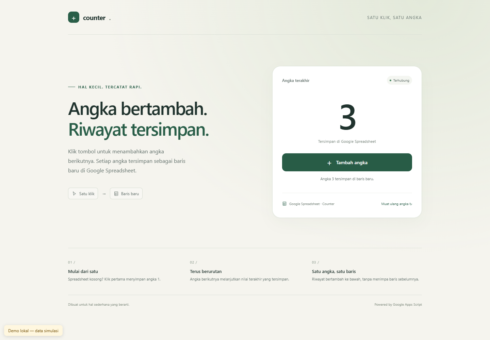

# Counter · Google Apps Script + Spreadsheet

Website sederhana yang dihosting oleh Google Apps Script. Setiap klik **Tambah angka**
membaca angka terakhir, menambahkan satu, lalu menyimpannya pada baris baru di Google
Spreadsheet. Sheet `Counter` tidak memakai header: klik pertama mengisi `A1` dengan
`1`, klik berikutnya mengisi `A2` dengan `2`, dan seterusnya. Membuka website hanya
membaca angka; tidak menambahkan baris.



Screenshot di atas berasal dari **preview lokal dengan data simulasi**, bukan
deployment Google atau bukti perubahan Spreadsheet. Repository tidak menyertakan
target deployment, Spreadsheet ID, atau kredensial Google.

## Persiapan lokal

Gunakan Node.js 22 atau lebih baru dan npm. Dependency proyek berada di
`node_modules/`, serupa dengan isolasi dependency Python di `.venv`. Node.js tetap
memakai runtime sistem; `node_modules/` hanya mengisolasi dependency. Tidak ada
langkah aktivasi.

Contoh menggunakan `npm.cmd` di Windows PowerShell agar argumen seperti `--version`
diteruskan ke clasp dengan benar, menghindari wrapper `npm.ps1`. Di shell lain,
gunakan `npm` seperti biasa.

```powershell
npm.cmd ci
npm.cmd run clasp -- --version
npm.cmd test
npm.cmd run preview
```

Buka URL lokal yang tercetak oleh preview. Preview memakai HTML aplikasi yang sama
dengan pengganti `google.script.run` dan data simulasi. Tidak ada akses akun Google
atau Spreadsheet; simulasi direset ketika halaman dimuat ulang. Node.js
tidak menyediakan layanan GAS seperti `SpreadsheetApp`; clasp mengelola file dan
proyek, bukan mengemulasikan runtime Google.

`package-lock.json` mengunci versi dependency. `node_modules/` tidak disimpan di Git.

## Hubungkan proyek Apps Script

1. Buat Google Spreadsheet kosong. Salin ID dari URL
   `https://docs.google.com/spreadsheets/d/SPREADSHEET_ID/edit`.
   Aplikasi membuat sheet `Counter` saat klik pertama. Jika dibuat manual,
   biarkan sheet kosong tanpa header dan gunakan khusus untuk counter.
2. Buat proyek standalone melalui [editor Apps Script](https://script.google.com/)
   (**New project**) atau gunakan proyek khusus aplikasi ini. Salin
   **Project Settings > Script ID**.
3. Aktifkan Google Apps Script API di
   [pengaturan Apps Script](https://script.google.com/home/usersettings), lalu login:

   ```powershell
   npm.cmd run clasp -- login
   Copy-Item .clasp.example.json .clasp.json
   ```

4. Edit `.clasp.json`: isi `scriptId` dengan **Script ID proyek Apps Script** dan
   pertahankan `"rootDir": "src"`. Script ID berbeda dari Spreadsheet ID.
   Buat proyek di editor dan gunakan konfigurasi contoh agar sumber `src/` serta
   manifest tetap utuh; jangan menjalankan `clone-script` ke `src/` yang sudah terisi.
5. Di **Project Settings > Script Properties**, tambahkan:

   | Property | Value |
   | --- | --- |
   | `SPREADSHEET_ID` | ID Google Spreadsheet dari langkah pertama |

   Property wajib diisi. Akun yang menjalankan aplikasi harus memiliki akses edit
   ke Spreadsheet. Gunakan ID, bukan URL lengkap atau Script ID.
6. Periksa file yang akan dikirim, lalu unggah sumber:

   ```powershell
   npm.cmd run clasp -- show-file-status
   npm.cmd run clasp -- push
   npm.cmd run clasp -- open-script
   ```

   `push` menyinkronkan kode proyek Google dengan sumber lokal; gunakan proyek
   khusus aplikasi ini. `.clasp.json` dan `.clasprc*.json` diabaikan Git. Kredensial
   login biasanya disimpan oleh clasp di direktori pengguna.

## Hosting website di Google Apps Script

Di editor, pilih **Deploy > New deployment > Web app**:

- **Execute as:** akun Anda/pemilik proyek.
- **Who has access:** **Only myself** untuk penggunaan awal.
- Klik **Deploy**, selesaikan otorisasi Spreadsheet, lalu buka URL web app `/exec`.

Klik tombol beberapa kali dan periksa sheet `Counter`: angka berurutan harus
muncul di kolom A pada baris berbeda. Muat ulang halaman untuk memeriksa bahwa
angka dibaca dari Spreadsheet. Pilihan akses dapat bergantung pada akun dan
kebijakan Google Workspace. Jika akses dibuka untuk orang lain, setiap pengunjung
yang diizinkan dapat menambah counter memakai otorisasi pemilik deployment.

Untuk pembaruan, jalankan `push`, lalu **Deploy > Manage deployments**, edit
deployment, pilih **New version**, dan deploy kembali. `push` saja belum mengubah
versi yang dilayani URL `/exec`. Tidak ada sinkronisasi atau deployment otomatis.

Dokumentasi resmi: [web apps dan deployment](https://developers.google.com/apps-script/guides/web),
[google.script.run](https://developers.google.com/apps-script/guides/html/communication),
dan [LockService](https://developers.google.com/apps-script/reference/lock/).

## Arsitektur dan SOLID

| File | Tanggung jawab |
| --- | --- |
| `src/Code.js` | `doGet()` menyajikan HTML; `getCounterState()` dan `incrementCounter()` menjadi API. Membentuk dependency saat request masuk. |
| `src/CounterService.js` | Aturan domain: membaca, memvalidasi integer aman, dan menentukan angka berikutnya. |
| `src/SpreadsheetCounterRepository.js` | Membaca sheet `Counter`, menambahkan baris, dan melakukan `SpreadsheetApp.flush()`. |
| `src/ScriptLock.js` | Callback dalam script lock yang selalu dilepas melalui `finally`. |
| `src/Index.html` | UI responsive Indonesia, status loading/sukses/error, komunikasi asinkron. |
| `src/appsscript.json` | Runtime V8, zona waktu, logging, dan scope Spreadsheet. |

Komponen memiliki satu tanggung jawab (**SRP**). `CounterService` menerima repository
dan lock lewat constructor (**DIP**), dengan kontrak kecil
`readLastValue()/append(value)` dan `runExclusive(callback)` (**ISP**). Adapter lain
dapat menggantikan penyimpanan atau lock tanpa mengubah aturan domain (**OCP**),
selama menjaga kontrak nilai dan eksklusivitas (**LSP**).

API mengembalikan `{ value: number }`. Sheet kosong berarti nilai awal `0`.
Dependency dibuat saat API dipanggil sehingga kode tidak bergantung pada urutan
evaluasi file GAS. Helper global berakhiran `_` tidak dapat dipanggil melalui
`google.script.run`.

Tambah angka memakai `LockService.getScriptLock()` dengan batas tunggu 30 detik.
Pembacaan, validasi, penambahan baris, dan `SpreadsheetApp.flush()` selesai sebelum
lock dilepas. Klik bersamaan pada **proyek Apps Script yang sama** tetap berurutan.
Pengeditan manual atau aplikasi/proyek lain tidak memakai lock ini; jangan menulis
ke sheet `Counter` melalui jalur tersebut.

Jika nilai terakhir berupa teks, header, angka negatif/nol, pecahan, atau bukan
integer aman JavaScript, request gagal tanpa menambahkan baris. Penambahan juga
berhenti pada `Number.MAX_SAFE_INTEGER`. Validasi memeriksa nilai terakhir;
aplikasi tidak mengaudit atau memperbaiki seluruh riwayat.

Tombol dinonaktifkan selama request. Saat gagal, angka terakhir yang terkonfirmasi
tetap ditampilkan dan tombol tambah menunggu **Muat ulang angka**. Respons bisa
gagal setelah server menulis baris, sehingga tidak ada retry otomatis. Pembacaan
ulang memastikan UI mengikuti Spreadsheet sebelum klik berikutnya.

## Verifikasi dan screenshot

```powershell
npm.cmd test
npm.cmd run preview
npm.cmd run screenshot
```

Test backend berjalan di Node.js dengan layanan GAS pengganti; tidak memerlukan
login Google. Preview dan screenshot memakai data demo lokal. Screenshot desktop
tersimpan di `docs/images/counter-demo.png`, mobile di
`docs/images/counter-demo-mobile.png`.

Hasil verifikasi implementasi: **21 test backend lulus** dan smoke test browser
desktop/mobile lulus, termasuk klik ganda, pemulihan setelah gagal, aktivasi
keyboard, tampilan mobile tanpa overflow, dan tidak ada error JavaScript browser.

Screenshot memerlukan Playwright dan Chromium/Chrome. Jika belum tersedia, pasang
alat screenshot tanpa menambahkannya ke dependency proyek:

```powershell
npm.cmd install --no-save --package-lock=false playwright
npm.cmd exec -- playwright install chromium
npm.cmd run screenshot
```

Jika alat tersedia di lokasi lain, script mendukung `PLAYWRIGHT_MODULE_PATH` dan
`BROWSER_EXECUTABLE_PATH`. Tes lokal memeriksa kontrak dengan pengganti layanan;
otorisasi, deployment, dan penulisan Google perlu diverifikasi melalui langkah
hosting dengan akun serta Spreadsheet Anda sendiri.
